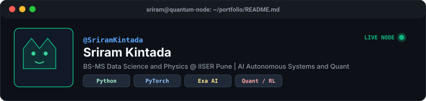
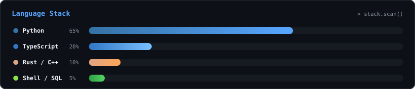
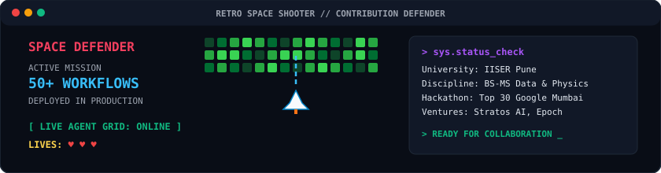
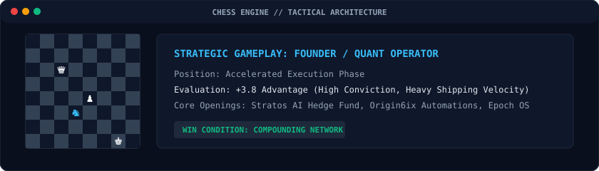

<div align="center">



<p align="center">
  <a href="https://github.com/SriramKintada"></a>
  <a href="mailto:kintadasrirama3637f@gmail.com"></a>
  <a href="https://twitter.com"></a>
</p>

</div>

---

### Terminal Session

```bash
sriram@quantum-node:~$ neofetch
```

```text
       ___          ___         OS: Arch Linux x86_64 / Windows 11
      /  /\        /__/\        Host: IISER Pune (BS-MS Data Science and Physics)
     /  /:/        \  \:\       Uptime: 2023 to 2028
    /__/::\         \  \:\      Kernel: Quant-Engine-v9.4
    \__\/\:\    ___  \  \:\     Focus: Autonomous AI Agents, Quant Finance, RAG
       \  \:\  /__/\  \__\:\    Hackathon: Top 30 of 600+ (Google Mumbai Hackathon)
        \__\/  \  \:\ /  /:/    Production: 50+ n8n Automations Shipped
                \  \:\  /:/     Status: Building Sovereign Autonomous Systems
                 \  \:\/:/      Location: India (IST / UTC+5:30)
```

---

### Language Stack

<div align="center">
  
</div>

---

### Live Telemetry

<div align="center">
  
  
</div>

---

### Featured Deployments

<table>
  <tr>
    <td width="50%" valign="top">
      <h3>⚡ <a href="https://github.com/SriramKintada/indie-talent-scout">indie-talent-scout</a></h3>
      <p><b>Autonomous creative talent and subculture scouting engine for India.</b> Powered by Exa AI neural search. Discovers lowkey bedroom pop musicians, indie singers, and visual craftsmen bypassing algorithmic vanity.</p>
      <p>
        
        
        
      </p>
    </td>
    <td width="50%" valign="top">
      <h3>📈 <a href="https://github.com/SriramKintada/stratos-paper-trading">stratos-paper-trading</a></h3>
      <p><b>Stratos AI Hedge Fund: V9 Paper Trading System.</b> Reinforcement learning and regime detection on live market feeds with institutional risk guardrails.</p>
      <p>
        
        2.0-yellow?style=flat-square" />
        
      </p>
    </td>
  </tr>
  <tr>
    <td width="50%" valign="top">
      <h3>🛡️ <a href="https://github.com/SriramKintada/aegis-trading-agent">aegis-trading-agent</a></h3>
      <p><b>Autonomous trading agent on Base mainnet.</b> Radical transparency engine with verifiable on-chain trade execution and immutable audit logging.</p>
      <p>
        
        
      </p>
    </td>
    <td width="50%" valign="top">
      <h3>🏛️ <a href="https://github.com/SriramKintada/epoch-incubator-os">epoch-incubator-os</a></h3>
      <p><b>EPOCH Sovereign Incubator OS v5.0.</b> Multi-persona deep-tech incubation operating system for founders, mentors, operators, and capital allocators.</p>
      <p>
        
        
      </p>
    </td>
  </tr>
</table>

---

### Arcade Mode: Space Defender

<div align="center">
  
</div>

---

### Strategic Architecture: Tactical Board

<div align="center">
  
</div>

---

<div align="center">
  <p><b>Engineered with precision by Sriram Kintada</b></p>
  <p>IISER Pune | BS-MS Data Science and Physics</p>
</div>
